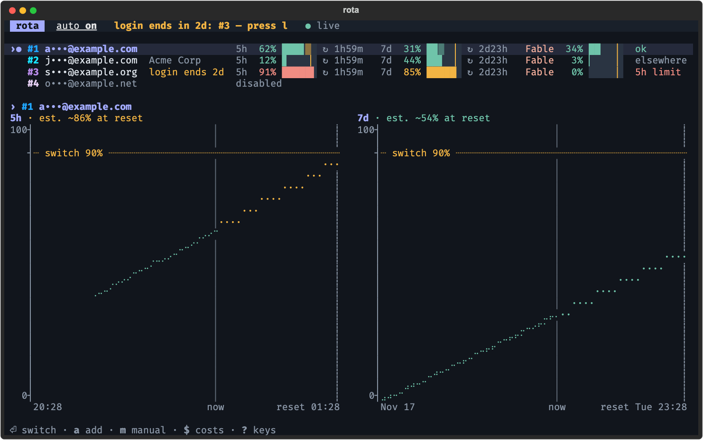
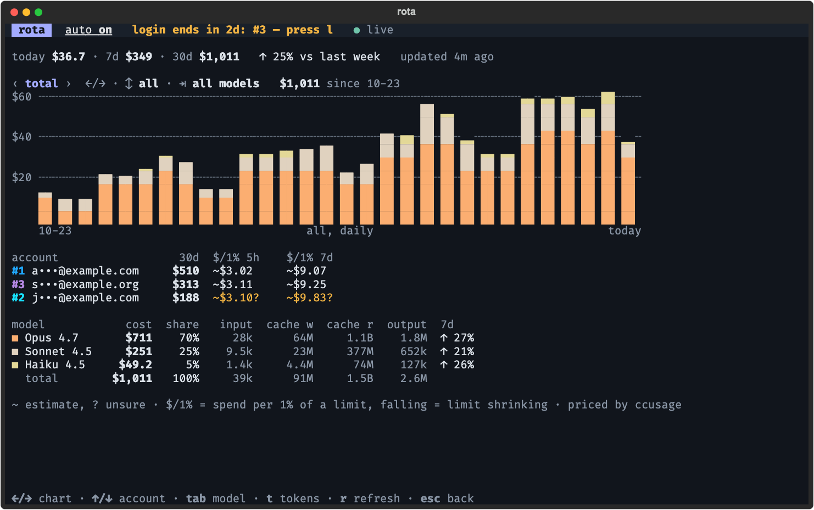

# rota

Keep several Claude Code accounts logged in and let rota switch between them,
so you use every account's weekly quota before it resets and never stall at a
limit.



## Install

You need [uv](https://docs.astral.sh/uv/) and
[Claude Code](https://docs.claude.com/en/docs/claude-code) (the `claude`
command). uv fetches Python 3.12 or newer if you don't have it.

```bash
uv tool install git+https://github.com/RyanKim17920/rota
rota --version
```

Upgrade with `uv tool upgrade rota-cli`.

The package was called claude-rotater, then rota; `upgrade` can't follow a rename. If
`uv tool list` shows either name, quit rota, run `uv tool uninstall claude-rotater` (or
`uv tool uninstall rota`), then install again (git as above, or `--editable <checkout>`).

Works on macOS, Linux and Windows. On macOS, stored logins live in the
Keychain. On other systems they are files readable only by you (mode 0600).
The statusline feed needs a POSIX shell, so it works on macOS and Linux.

## Quick start

1. **Open the TUI:** run `rota`.
2. **Add accounts:** press `a`, then pick how:
   - `b` log in with the browser (runs `claude auth login` in a separate
     profile, so the account you're using now stays logged in). You never
     leave the TUI: the browser opens, the bottom line shows progress, and
     if the sign-in page shows a code you paste it there. `ctrl+o` opens
     the page again, `ctrl+y` copies its link, `esc` cancels.
   - `c` add the account Claude Code is logged in with right now
   - `t` paste a setup token
   - `k` an API key (see [API-key accounts](#api-key-accounts))

   Never use `/logout` in Claude Code to change
   accounts: it can revoke the stored login.
3. **Connect the statusline feed:** press `s`. Claude Code passes the active
   account's live usage to its statusline command on every refresh, and `s`
   adds `rota feed` to that command (or installs a small statusline if you
   have none). Until then the header shows `feed: not set up` and rota
   finds out about usage by polling.
4. **Leave it running.** While the TUI is open it switches accounts on its
   own. Running chats pick up the new login by themselves, usually within
   half a minute.

Everything else (logins, removing accounts, settings) is done in the TUI.
Questions and text entry show on the bottom line. `esc` cancels.

## How rotation works

The default strategy is `pace`:

- **The 7-day window is what counts.** Weekly quota you don't use by the
  reset is lost. A 5-hour window only limits how fast you can spend, so 5h
  room is a constraint and a tie-breaker, never the reason for a planned
  move.
- **Earliest reset first, with as few switches as possible.** rota plans the
  remaining weeks at your usual spend per hour. It stays on the current
  account if finishing it first still leaves time to use up every other
  account's week. It moves only when staying would leave some weekly quota
  unused, and then to the account that saves the most.
- **Cache-aware timing.** A switch makes every open chat rebuild its prompt
  cache on the new account. So a planned move waits until no local chat has
  answered for an hour (the cache lifetime), shown as
  `switch → #2 when idle (cache warm)`. If waiting could cost the target's
  week, it moves at once. An urgent move waits 30 minutes at most.
- **Limits.** At the threshold (default 90%) of the binding window rota
  moves at once, and it moves early when the next reading would cross it.
  A model's weekly limit (for example Fable) binds when your chats run that
  model. Moves at a limit never wait for idle caches.
- **Use elsewhere.** Every account is polled (every 10 minutes, every 5
  while its usage climbs), so use from another machine, SSH or claude.ai
  shows up. An account whose usage rises while another account is active
  here is marked `elsewhere`, and the plan allows for that use for a short
  while.
- **Accounts rota leaves alone:** accounts you turn off with `d`, accounts
  whose login died (`re-login`, press `l`), and accounts the provider
  refuses to serve (`suspended`, for example after a payment problem). They are never picked, and rota leaves one at once if it is the
  active account. Press `d` to put an account back once it works again.
- **Safety limits.** At most 4 automatic switches an hour, at least 5
  minutes between planned moves, and no planned move for an hour after you
  switch by hand.

Other strategies (`autoswitch.strategy`): `expiring-first` (spend the
account whose week resets soonest), `best` (most quota left, only at the
threshold) and `consume-first` (strictly the soonest weekly reset). Press
`m` for manual mode: you pick with `enter`, and rota only steps in at a hard
limit or a dead login (`autoswitch.manualLimitGuard`).

Every verdict says why, for example
`switch → #2: #2's week resets in 9h with 40% left (needs 4.4%/h)`.

## Keys

| Key | Action |
|-----|--------|
| `↑` `↓` / `j` `k` | move |
| `enter` | switch to the highlighted account |
| `a` | add an account (browser login, current login, token, API key) |
| `l` | log in, or log a `re-login` account back in |
| `t` | paste a setup token or API key |
| `b` | set an API key's budget (`50` = $50 from now, `100/m` monthly, empty clears) |
| `d` | take an account out of rotation, or put it back |
| `x` | remove an account |
| `m` | auto or manual mode (clicking the header also toggles it) |
| `h` | history: past 5h peaks and the 7d curve across weeks |
| `$` | costs (see below) |
| `f` | refresh usage now |
| `y` / `Y` | copy the highlighted row / every row as text |
| `s` | set up or remove the statusline feed |
| `S` | give this profile its own `settings.json` (needed for API keys when it is shared) |
| `c` | settings |
| `ctrl+t` | theme |
| `?` | every key, in the TUI |
| `esc` | back |
| `q` / `ctrl+c` | quit |

rota captures the mouse. To select text, hold Option (macOS) or Shift
(most other terminals) while dragging.

## Costs



Press `$` for what your chats cost: today, 7 days and 30 days, a chart by
model, each account's spend and its approximate dollars per 1% of its 5h and
7d windows, and a table of tokens per model. Spend is credited to the
account that was active at the time. Spend rota can't place is shown as `?`
rather than guessed.

| Key | Action |
|-----|--------|
| `←` `→` | chart: all history, 30 days, the last week, the last day, then the $ per 1% trend |
| `↑` `↓` | whose spend: all, stacked by account, or one account |
| `tab` / `shift+tab` | which model: all, or one |
| `t` | dollars or tokens |
| `r` | reprice now |
| `y` / `Y` | copy the summary / the page |

Prices come from [ccusage](https://github.com/ryoppippi/ccusage), run on
your local transcripts when you open the page. It needs `ccusage` on your
PATH, or Node or Bun so rota can fetch it with `npx`/`bunx`.

## Configuration

### Settings

Press `c`. `↑`/`↓` select, `←`/`→` change, digits or `enter` type a value,
`ctrl+r` resets to the default. Settings are saved in
`~/.rota/settings.json`.

| Setting | Default | What it does |
|---------|---------|--------------|
| `autoswitch.strategy` | `pace` | `pace`, `expiring-first`, `best` or `consume-first` |
| `autoswitch.mode` | `auto` | `manual`: you choose, rota acts only at a hard limit |
| `autoswitch.manualLimitGuard` | on | in manual mode, still leave an account at its limit or with a dead login |
| `autoswitch.threshold` | 90 | switch when the binding window reaches this % |
| `autoswitch.cooldownSeconds` | 300 | minimum time between planned switches |
| `autoswitch.hysteresisPct` | 10 | a target must beat the active account by this many points |
| `autoswitch.paceMargin` | 1.5 | pace: concentrate on an account that needs spending this many times faster |
| `autoswitch.similarResetHours` | 12 | expiring-first: weekly resets this close count as tied |
| `autoswitch.manualHoldMinutes` | 60 | no planned switch for this long after you switch by hand |
| `autoswitch.maxSwitchesPerHour` | 4 | one more pauses automatic switching until the hour clears |
| `autoswitch.model` | (unset) | extra models whose weekly limits count (`Fable`, `Fable,Opus`, `all`); `none` ignores model limits |
| `autoswitch.includeApiKeyAccounts` | on | allow switching to API-key accounts |
| `autoswitch.unhealthyTicks` | 3 | dead-login readings in a row before rota fails over |
| `autoswitch.pollSpareSeconds` | 600 | seconds between usage polls of each account |
| `autoswitch.pollHourlyBudget` | 20 | most polls per account per hour |
| `autoswitch.feedStaleSeconds` | 600 | poll the active account again once the feed has been quiet this long |
| `ui.theme` | `auto` | `dark`, `light` or `auto` (follows the terminal) |
| `ui.loginWarnDays` | 3 | warn when a stored login ends within this many days |
| `ui.loginNotify` | on | macOS notification when a login dies or is about to |
| `run.shareDefault` | on | `rota run` shares your main settings, CLAUDE.md and skills |
| `accounts.oauthOnly` | off | never switch to API-key accounts |
| `accounts.order` | `account-first` | when to use API keys (see below) |
| `accounts.proactiveTokenRefresh` | off | refresh idle accounts' tokens early (only if nothing else can hold them) |

### Profiles

rota keeps its data in `~/.rota`. Set `ROTA_HOME` to run a separate profile
with its own accounts and settings, for example a work setup that uses its
own `CLAUDE_CONFIG_DIR`:

```bash
ROTA_HOME=~/work/.rota CLAUDE_CONFIG_DIR=~/work/.claude rota
```

Each profile switches only its own Claude Code login. Usage history belongs
to the account, not the profile, so an account held by two profiles is
polled once and shows the same forecast in both. Only one rota per profile
switches accounts; a second one opened on the same profile is view-only.

### API-key accounts

An API key (`a` then `k`) is an account like any other, billed per token
instead of by 5h and 7d windows. Its row shows this month's spend, what's
left of its budget (`b`), or `out of credit`.

- `accounts.order`: `account-first` (default) uses keys only once every
  subscription is at its limit. `api-first` uses a key until it runs out,
  then the subscriptions.
- rota switches to a key by pointing Claude Code's `apiKeyHelper` at
  `rota key`. Your subscription login is never touched. If this profile's
  `settings.json` is shared with another profile (a symlink), press `S` to
  give it its own copy first.
- When the API refuses a key for lack of credit, rota sees it in the chat
  transcript, marks the key `out of credit` and moves off it. After a top-up,
  press `enter` on the key to try it again.

### Command line

The TUI is the main interface. These commands cover the rest:

```bash
rota                              # the TUI
rota switch                       # rotate to the next account
rota switch <num|email>           # switch to one account
rota switch --strategy best       # the account with the most quota left
rota status [--json]              # the current account
rota run <num|email> [-- args]    # run Claude Code as another account, this terminal only
rota auto                         # auto-switching without the TUI (rota auto -h)
rota feed [--tee | --line]        # statusline input (set up by `s`)
```

`rota run` (experimental) lets two accounts work side by side without
changing the default login.

To wire the feed by hand, put `rota feed --tee` in front of your statusline
command (`"command": "rota feed --tee | ~/.claude/statusline.sh"`), or use
`rota feed --line` as the whole statusline. `rota feed` never fails, so it
can't break your statusline.

## Troubleshooting

- **Header says `feed: not set up`.** Press `s`. rota still works without
  the feed; it just reacts to the active account by polling.
- **`re-login`.** The provider refused the stored login. Highlight it
  and press `l`. Check your network first: an outage looks the same from
  inside Claude Code.
- **`suspended`.** The provider won't serve that account (often a billing or
  organization setting). rota checks it again daily; once it's fixed on the
  account's side you can also press `d` to bring it back at once.
- **rota isn't switching.** Check the header: `manual` mode, a second rota
  that is only viewing, or the hourly switch limit. The bottom line says why
  rota is staying.
- **`Keychain locked: unlock it to switch`.** A locked Mac (for example,
  over SSH after a reboot, before anyone logs in at the screen) can't
  rotate. Claude Code reads the Keychain first, and rota can't replace or
  clear the old login there, so it leaves the current account in place
  and tries again every minute. Unlock it with `security unlock-keychain`
  or by logging in at the Mac.
- **Logs** are in `~/.rota/rota.log` (or `$ROTA_HOME/rota.log`). Start with
  `--debug` for more detail.
- **Coming from claude-swap.** On first run, if `~/.rota` doesn't exist yet,
  rota copies accounts and settings from a claude-swap store and leaves the
  original untouched. Create `~/.rota` first to start empty. A `ROTA_HOME`
  profile imports only when `ROTA_IMPORT_FROM` names the store.

## Uninstall

1. In the TUI, press `s` to remove the statusline feed (restores your
   original statusline command).
2. `uv tool uninstall rota-cli`
3. Delete `~/.rota` (and any `ROTA_HOME` directories).
4. On macOS, delete the Keychain items whose service is `rota` or
   `rota-<8 hex digits>` (Keychain Access, or
   `security delete-generic-password -s rota` repeated until it fails).

## License

MIT. Based on claude-swap by realiti4.
